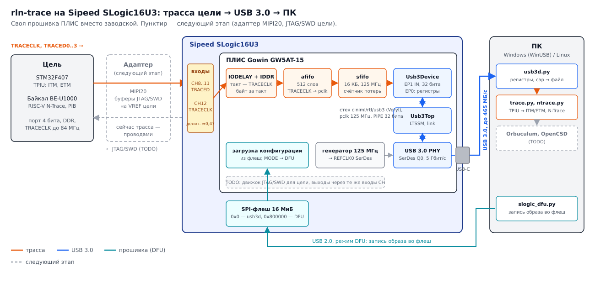

# rln-trace

**Приёмник параллельной трассы ARM Cortex-M и RISC-V на Sipeed SLogic16U3 — непрерывный поток на ПК по USB 3.0.**

*Open-source parallel-trace receiver built on the Sipeed SLogic16U3 logic analyzer: own FPGA image (Gowin GW5AT-15)
captures TPIU / RISC-V PIB trace (4 bits, DDR) and streams it to the PC over USB 3.0. BSD-3-Clause.*

> **Публичный проект — [slogic16u3-trace](https://github.com/radiolok/slogic16u3-trace)** (подмодуль
> [`slogic16u3-trace/`](slogic16u3-trace/), на английском, с CI и готовым образом в релизах). Здесь —
> исследовательский репозиторий: журналы, опыты, стенды и прочие варианты зонда.

## Что это и зачем

Отладчик показывает, где процессор остановился. Трасса показывает, что он делал на самом деле: каждый переход,
каждое прерывание, время реакции. Для этого у Cortex-M есть порт TPIU (ITM, ETM), у RISC-V — PIB (N-Trace):
4 линии данных и такт, данные по обоим фронтам. Открытых приёмников почти нет:
[ORBTrace](https://github.com/orbcode/orbtrace) не купить, коммерческие зонды стоят очень дорого.

rln-trace превращает недорогой серийный логический анализатор **Sipeed SLogic16U3** в такой приёмник. В нём уже есть
всё нужное железо: ПЛИС Gowin GW5AT-15 с SerDes, USB 3.0 на ней же, 16 входов. Заводская прошивка зашифрована,
поэтому здесь — своя: другой битстрим ПЛИС, прибор не вскрывается и не дорабатывается.

Что есть сейчас:

- **Приём трассы от TRACECLK цели**: IDDR по обоим фронтам, своя задержка IODELAY у каждой линии (~12,5 пс шаг).
  Проверено: STM32F407 (TPIU, ITM и ETM) чисто до TRACECLK 57 МГц на штатных проводах анализатора, RISC-V
  Байкал BE-U1000 (N-Trace) — на 25 и 50 МГц ([журнал трассы STM32](doc/slogic-trace-journal.md),
  [журнал BE-U1000](doc/beu1000-trace-journal.md)).
- **USB 3.0 SuperSpeed** своим образом: стек [ciniml/rtl/usb3](tools/slogic/usb3/ciniml/) поверх USB 3.0 PHY Gowin,
  до **465 МБ/с** на ПК без ошибок; драйвер WinUSB Windows ставит сама (MS OS 2.0)
  ([журнал USB](doc/slogic-usb-journal.md)).
- **Поток трассы в USB 3.0**: IDDR → FIFO → EP1 IN, счётчики слов и потерь, частотомер TRACECLK, регистры по EP0
  ([`usb3d.v`](tools/slogic/usb3/usb3d.v)). BE-U1000 на 50 МГц: 1 ГБ трассы за 20 с без единой потери и ошибки;
  STM32F407 на 50 МГц: ITM и ETM разбираются по всей записи.
- **Разбор на ПК**: TPIU → ITM/ETM (декодер ETMv3 по правилам OpenCSD) и RISC-V N-Trace по ELF
  ([`trace.py`](tools/slogic/trace/trace.py), [`ntrace.py`](tools/slogic/trace/beu1000/ntrace.py)).
- **Без доработок и без программатора**: образ пишется во флеш прибора по USB через заводской загрузчик DFU,
  кнопка MODE возвращает в DFU, заводская прошивка восстанавливается из дампа.

## Как это работает



Цель выдаёт трассу на входы CH8..CH12 анализатора: TRACED0..3 и TRACECLK. TRACECLK идёт на глобальную тактовую сеть
ПЛИС, данные — через IODELAY в IDDR: байт за такт TRACECLK, четыре байта — 32-битное слово. Слова переходят в домен
USB (125 МГц) через асинхронный FIFO, копятся в FIFO на 16 КБ и уходят в конечную точку EP1 IN — по слову за такт,
то есть до 500 МБ/с внутри и около 465 МБ/с на шине. Потери (если ПК не успевает забирать) считаются до слова на
каждом стыке. На ПК `usb3d.py` пишет поток в файл, декодеры разбирают TPIU/ITM/ETM или N-Trace.

Образ лежит во флеш прибора по адресу `0x0`, заводской загрузчик DFU — по `0x800000`; в образ вписан переход на него,
поэтому кнопка MODE всегда возвращает прибор в DFU. Писать флеш можно прямо по USB, программатор не нужен.

## Как начать

### Что купить

| Что | Зачем |
|---|---|
| [Sipeed SLogic16U3](https://wiki.sipeed.com/hardware/en/logic_analyzer/slogic16u3/index.html) | приёмник |
| Кабель USB-C с линиями SuperSpeed (родной из комплекта) | USB 3.0: кабель «для зарядки» даёт только USB 2.0 — линк не поднимется |
| Цель с 4-битным портом трассы: STM32F4-Discovery (STM32F407) или Байкал BE-U1000 (EVU-BA-2.5) | источник трассы |

### Что установить

| Что | Где используется |
|---|---|
| Gowin EDA 1.9.12.04 (Windows; лицензия для GW5AT) | синтез и разводка; скрипты зовут её из WSL |
| [OSS CAD Suite](https://github.com/YosysHQ/oss-cad-suite-build) в `~/.local/opt/oss-cad-suite` | iverilog, Verilator (симуляция, линт) |
| [Veryl](https://veryl-lang.org) 0.22 (готовый бинарник в `PATH`) | стек USB 3.0 |
| Python 3 на Windows: `pip install libusb1 numpy pyusb libusb-package` | запись флеш через DFU, приём потока |
| WSL2 (Ubuntu) | сборка (скрипты зовут Gowin EDA из WSL), декодеры |

### Собрать, загрузить, запустить

```sh
sh tools/slogic/usb3/build.sh d                 # IP Gowin из своей EDA, 4 расстановки → usb3d.bin
PY="/mnt/c/Program Files/Python310/python.exe"  # Python Windows: DFU и поток идут без usbipd
DFU="$PY $(wslpath -w tools/slogic/slogic_dfu.py)"
# кнопка MODE → DFU (359f:30f1, мигает красным)
$DFU dump slogic16u3-factory.bin                                        # один раз: полный дамп своего прибора
$DFU write $(wslpath -w tools/slogic/usb3/usb3d.bin) --backup slogic16u3-factory.bin   # ~50 с, со сверкой
# переподключить USB → 1209:0001 на 5 Гбит/с; MODE снова даёт DFU; заводская: $DFU restore slogic16u3-factory.bin
"$PY" $(wslpath -w tools/slogic/usb3/host/usb3d.py)                         # линк, частота TRACECLK, счётчики
"$PY" $(wslpath -w tools/slogic/usb3/host/usb3d.py) --dly 208 208 208 208 cap -s 5 -o run.bin   # трасса в файл
# IODELAY зависит от цели: BE-U1000 — 208, STM32F407 — 40; разбор: ntrace.py decode run.bin / trace.py decode run.bin
```

Проводка: TRACED0..3 → CH8..CH11, TRACECLK → CH12, земля — к GND гребёнки.

Для разработки образ удобнее грузить в SRAM по JTAG ПЛИС (разъём JST SH 8 на плате, FT2232H, `openFPGALoader -m
usb3d.fs`) — там же OpenOCD читает состояние USB-линка и журнал пакетов (`host/u3status.py`). Для работы это не нужно.

Подробности:

- [doc/slogic-usb-journal.md](doc/slogic-usb-journal.md) — USB 2.0 и 3.0: сборка, команды, замеры, находки;
- [doc/slogic-trace-journal.md](doc/slogic-trace-journal.md) — приём трассы STM32: проводка, ITM, ETM, частоты;
- [doc/beu1000-trace-journal.md](doc/beu1000-trace-journal.md) — RISC-V N-Trace с BE-U1000;
- [doc/slogic-pinmap-journal.md](doc/slogic-pinmap-journal.md) — какие выводы ПЛИС куда идут, настройки входов;
- [tools/slogic/README.md](tools/slogic/README.md) — флеш прибора, DFU, восстановление, плата и разъём JTAG;
- [doc/bench.md](doc/bench.md) — стенды.

## JTAG и SWD цели — следующий этап (TODO)

Сейчас прибор только принимает трассу; отлаживают цель её родные отладчики. Следующий шаг — свой адаптер к
SLogic16U3 с полноценным разъёмом **MIPI20** (Cortex Debug+ETM / RISC-V Trace Connectors) и буферами JTAG/SWD.

Идея: те же входы CH анализатора ПЛИС может вести и как выходы. Через входной делитель (~0,47) на гребёнку
выходит не полный уровень, а около 1,2 В — этого хватит, чтобы через «анти-делитель» на адаптере переключить буфер,
а уже он выдаст на цель уровень её VREF. Обратные линии (TDO, SWO) идут в CH как сейчас трасса.

- [ ] Замерить уровень выхода ПЛИС на гребёнке через делитель и фронты; выбрать буфер (порог, питание от VREF)
- [ ] Адаптер: MIPI20, буферы TCK/TMS/TDI/nRST с управлением направлением, VREF 1,2–3,6 В, защита
- [ ] Движок JTAG/SWD в ПЛИС, канал команд по USB 3.0
- [ ] Протокол на ПК: CMSIS-DAP v2 (OpenOCD, pyOCD, probe-rs без доработок) или драйвер OpenOCD
- [ ] Метки внешних событий (PPS GNSS) в шкале трассы — по входу CH

## Статус

- [x] Своя прошивка грузится в SLogic16U3 (флеш через DFU, SRAM через JTAG), прибор возвращается к заводской
- [x] Образ usb3d во флеш через DFU из Windows, без JTAG: грузится по питанию, MODE возвращает в DFU
- [x] Разводка входов: все 16 каналов, настройки входов
- [x] Приём трассы от TRACECLK: STM32F407 до 57 МГц, BE-U1000 на 25 и 50 МГц (буфер в ПЛИС, выгрузка по JTAG)
- [x] USB 2.0 HS своим образом: 46,5 МБ/с под Windows
- [x] USB 3.0 SuperSpeed: 465 МБ/с, тайминг 125 МГц закрыт
- [x] Поток трассы в USB 3.0 (`usb3d`): проверен тестовым источником
- [x] Поток трассы в USB 3.0 от настоящей цели: BE-U1000 (N-Trace, 50 МГц) — 20 с без потерь
- [x] STM32F407 (TPIU: ITM + ETM) через USB 3.0 на 50 МГц — сбои ~1 на 2 млн слов от жгута, нужен переходник
- [ ] TRACECLK выше 50 МГц через USB 3.0 (переходник вместо проводов)
- [ ] Захват без пауз хоста (WinUSB с RAW_IO или Linux)
- [ ] Мост в Orbuculum и OpenCSD
- [ ] JTAG/SWD цели (см. выше)
- [x] Публичный репозиторий на английском: [slogic16u3-trace](https://github.com/radiolok/slogic16u3-trace)
- [ ] Добавить возможность собирать 1 и 2 битовый режимы
- [x] CI (линт, тестбенчи, тесты декодеров) и релиз образа v0.1 — в slogic16u3-trace

## Структура

| Папка | Что внутри |
|---|---|
| [`slogic16u3-trace/`](slogic16u3-trace/) | подмодуль: публичный проект — образ usb3d, утилиты ПК, платы, CI |
| [`tools/slogic/usb3/`](tools/slogic/usb3/) | образ USB 3.0: `usb3d.v` (поток трассы), стек ciniml, сборка, симуляция, линт, утилиты ПК |
| [`tools/slogic/trace/`](tools/slogic/trace/) | приём трассы с выгрузкой по JTAG (`gw/tracela.v`), декодеры `trace.py` (TPIU/ITM/ETM), `beu1000/ntrace.py` |
| [`tools/slogic/usb2/`](tools/slogic/usb2/) | образ USB 2.0 HS (SoftPHY Gowin, ядро Daisho) |
| [`tools/slogic/`](tools/slogic/) | флеш и DFU (`slogic_dfu.py`), прозвонка выводов, частотомеры SerDes |
| [`gw/boards/slogic16u3/`](gw/boards/slogic16u3/) | разводка выводов SLogic16U3 |
| [`doc/`](doc/) | журналы работ, методики, рисунки |

## Лицензии

- Код, гейтвар, ПО: [BSD-3-Clause](LICENSE).
- `tools/slogic/usb3/ciniml/` — стек USB 3.0 и эталонный образ из [ciniml/fpga_samples](https://github.com/ciniml/fpga_samples)
  (К. Ида), Boost Software License 1.0, с правками (помечены `rln:`).
- `tools/slogic/usb2/serdes/` — настройка SerDes оттуда же, Boost Software License 1.0.
- `tools/slogic/usb2/daisho/` — USB2-ядро [Daisho](https://github.com/enjoy-digital/daisho) (Marshall H.), упрощённая BSD, с правками.
- Подмодули в `au/` сохраняют свои лицензии.

## Другой вариант: свой зонд на ПЛИС + CH569

Параллельно прорабатывается собственная плата — GW2AR-18 + WCH CH569W (USB 3.0), с SWD/JTAG, метками PPS и питанием
цели: [hw/README.md](hw/README.md), [doc/bench.md](doc/bench.md), [doc/ch569-hspi.md](doc/ch569-hspi.md).
