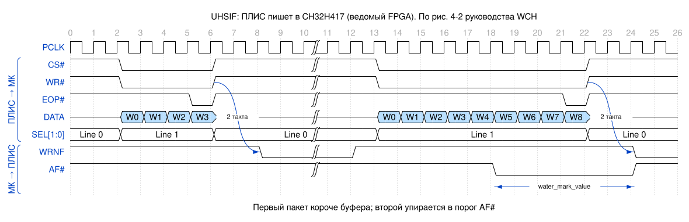
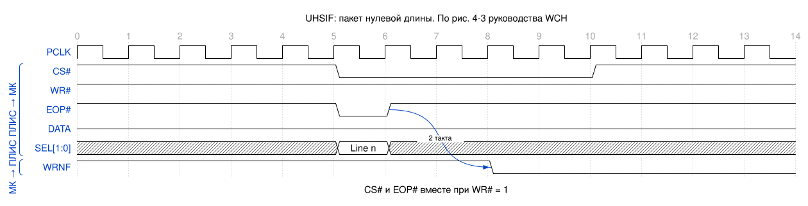
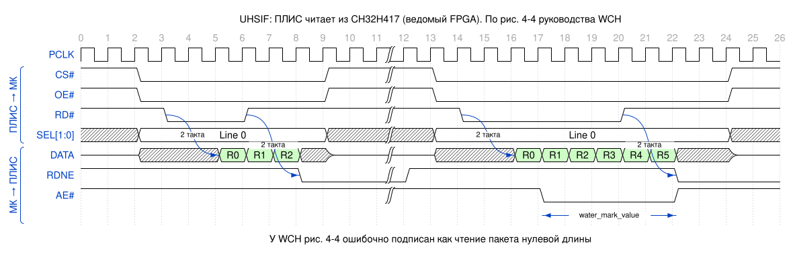
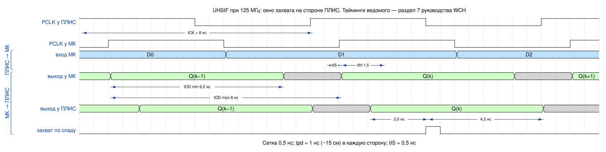
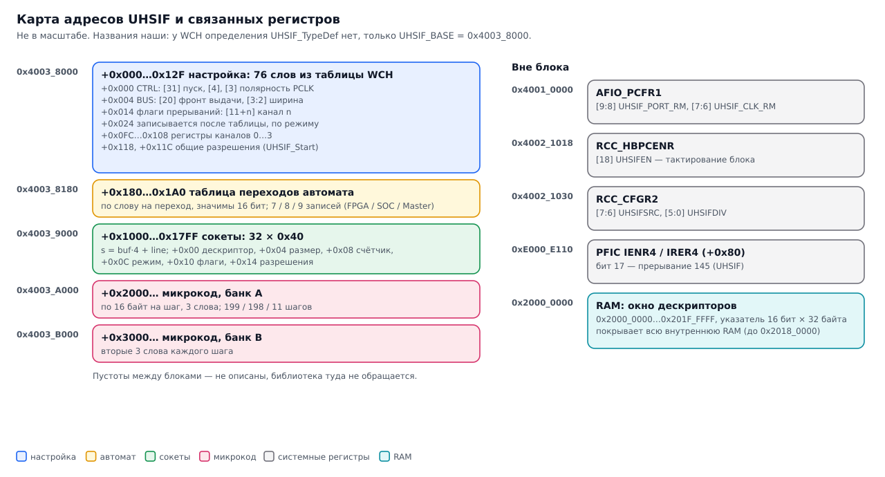
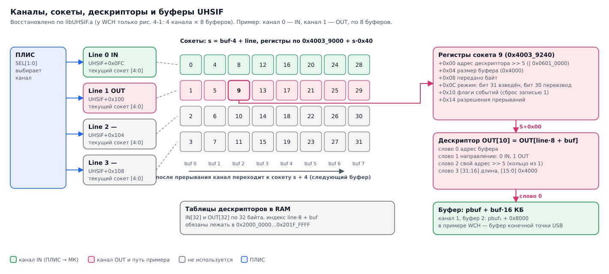
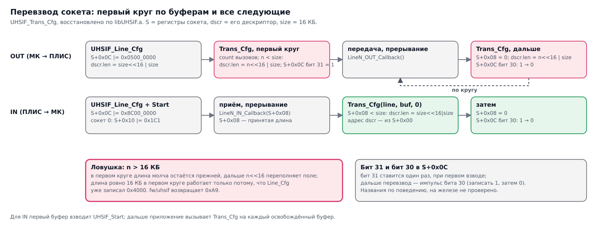
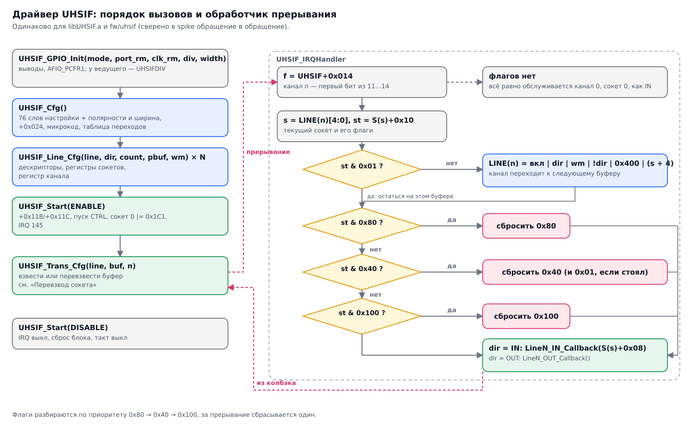

# CH32H417 UHSIF: заметки для разбора

Зачем: UHSIF — кандидат на шину ПЛИС → USB3-мост вместо HSPI у CH569 (см. [`hw/README.md`](../hw/README.md#альтернатива-ch569-ch32h417)).
Документированного описания регистров нет: шина настраивается только через закрытую библиотеку
`libUHSIF.a` из [openwch/ch32h417](https://github.com/openwch/ch32h417)
(`EVT/EXAM/UHSIF/UHSIF_SLAVE/Common/libUHSIF.a`). Цель разбора — описание регистров и
таблиц настройки в объёме, достаточном для своего открытого драйвера. Код библиотеки в репозиторий
не копируем.

## Шина со стороны ПЛИС

По UHSIF Development Reference Manual V1.0 (лежит в том же каталоге примеров).

| Сигнал | Ведущий (ПЛИС) | Ведомый (CH32H417) | Назначение |
|---|---|---|---|
| PCLK | выход | вход | Такт, до 125 МГц |
| CS# | выход | вход | Выбор |
| WR# | выход | вход | Запись |
| RD# | выход | вход | Чтение |
| OE# | выход | вход | Ведомый выводит данные на шину |
| EOP# | выход | вход | Конец пакета; вместе с CS# без WR# — пакет нулевой длины |
| SEL[1:0] | выход | вход | Номер канала (Line 0–3), переключение без задержки |
| DATA[31:0] | ввод/вывод | ввод/вывод | 8/16/24/32 бита |
| WRNF | вход | выход | Приёмный буфер не полон |
| AF# | вход | выход | Почти полон (порог — `water_mark_value`) |
| RDNE | вход | выход | Буфер передачи не пуст |
| AE# | вход | выход | Почти пуст |

Тайминги: WRNF снимается через 2 такта после подъёма WR#/EOP#; данные при чтении — через 2 такта после
RD#; RDNE снимается через 2 такта после подъёма RD#. Каждый канал — 8 буферов, всего до 32 путей.
Пины назначаются через `UHSIF_PORT_RM`; стандартная раскладка — таблица 3-2 руководства
(DATA на PORT[47:16], управление на PORT[15:3]), остальные — «через техподдержку».

Временные диаграммы перерисованы в WaveDrom с рис. 4-2…4-4 руководства (исходники —
[`tools/diagrams/wavedrom/`](../tools/diagrams/wavedrom/)). Синим — что выдаёт ПЛИС, зелёным — CH32H417.

ПЛИС пишет: ведомый принимает слово по фронту PCLK, пока CS# = 0 и WR# = 0. SEL[1:0] выбирает канал,
переключение — без пауз. WRNF опускается через 2 такта после подъёма WR#: буфер канала закрыт, а снова
поднимается, когда драйвер перевзвёл следующий буфер (предположение). AF# опускается за
`water_mark_value` до заполнения буфера, и ПЛИС должна успеть закончить пакет. EOP# = 0 на последнем
слове есть только на рисунке WCH; в тексте руководства для ненулевых пакетов о нём не сказано.

CS# и EOP# вместе при WR# = 1 — пакет нулевой длины в выбранный канал; WRNF опускается через 2 такта
после подъёма EOP#. На стороне МК это, по аналогии, прерывание с длиной 0 — не проверено.

ПЛИС читает: опускает CS# и OE# и отпускает DATA — шину ведёт ведомый. Данные приходят через 2 такта
после спада RD# и идут ещё 2 такта после его подъёма (конвейер). RDNE опускается через 2 такта после
подъёма RD#; AE# предупреждает о скором опустошении буфера. У WCH этот рисунок (4-4) ошибочно подписан
как «чтение пакета нулевой длины».

Электрика ведомого (там же, раздел 7): до 125 МГц (такт 8 нс) при CL ≤ 10 пФ; установка входа
tIS ≥ 0,5 нс, удержание tIH ≥ 1,5 нс, задержка выхода tOD 6,2…8 нс. При 125 МГц выход ведомого
приходит почти через целый такт. Отсюда настройка фронта выдачи данных (`DEF_SLAVE_DOUT_POLARITY`)
и сдвиг фазы захвата в ПЛИС.

Такт идёт от ПЛИС к МК (задержка платы tpd), данные — обратно (ещё tpd). Окно, в котором выход
ведомого стабилен на входе ПЛИС: [8 + 2·tpd; 14,2 + 2·tpd] нс от фронта ПЛИС. При tpd = 1 нс (~15 см)
это [10; 16,2]: по спаду PCLK (12 нс) остаётся 2,0 нс до и 4,2 нс после, из которых ещё вычитаются
tSU/tH ПЛИС и разброс линий. По следующему фронту (16 нс) захватывать нельзя — запас удержания 0,2 нс.
Варианты: спад, сдвиг фазы PLL, частота ниже. От какого фронта считать tOD при выдаче по спаду
(`DEF_SLAVE_DOUT_POLARITY = 0`), не сказано — проверить на плате.

Порог `water_mark_value` руководство считает так: «для буфера 16 К и опускания флага за 2 такта —
16384/16 − 2 = 4094». При этом описание параметра говорит о «словах», так что единицу надо проверить
на железе.

## Выводы и питание

По даташиту CH32H417/H416/H415 V1.8 (табл. 2-2-16; на wch.cn) и таблице 3-2 руководства. Раскладку,
которую `UHSIF_GPIO_Init` настраивает на самом деле, снял spike (`tools/uhsif-re/pinmap.py`), и она
совпадает с этими таблицами.

**Корпуса.** UHSIF есть в CH32H417QEU6 (QFN128) и CH32H416MEU6 (QFN88) полностью. В
CH32H415WEU6 (QFN68) он «неполный, только большая часть функций». `UHSIF_PORT_RM`: `00` — QFN128,
`01` — корпуса 56/68 выводов, `1x` — QFN88. В примере WCH стоит `PINREMAP2`.

**Питание.** Все выводы UHSIF относятся к домену **VIO18**: PA13…15, PB0…1, PB10…14, PC0…3,
PC6…12, PD0…7, PD9…15, PE0…1, PE7…15, PF0…5, PF11…14. VIO18 получается от встроенного регулятора
из VDDIO. Его напряжение задаётся программно (1,2 / 1,8 / 2,5 / 3,3 В, `PWR_CTLR[12:9]`, см.
CH32H417RM), а при включении — резистором с XO на землю: 60…110 кОм → 1,2 В, 220…400 кОм → 2,5 В,
≥ 1,2 МОм или вывод в воздухе → 1,8 В. Можно и замкнуть VIO18 на VDDIO. Для банка ПЛИС на 3,3 В
UHSIF надо переключить на 3,3 В. Условие «VDD18 = 1,8 В» в таблице таймингов, видимо, значит, что
125 МГц гарантированы при 1,8 В.

Отладочный интерфейс SDI — на PB8/PB9, с UHSIF не пересекается.

| Сигнал | PORT | RM=00 (QFN128) | RM=01 (QFN56/68) | RM=1x (QFN88) | Режим GPIO у библиотеки (ведомый FPGA) |
|---|---|---|---|---|---|
| SEL0 | 3 | PE8 | PC1 | PB0 | вход, подтяжка вниз |
| SEL1 | 4 | PE9 | PC2 | PB1 | вход, подтяжка вниз |
| AF# | 5 | PE10 | PC3 | PE10 | **вход с подтяжкой вверх** — хотя это выход ведомого, см. ниже |
| AE# | 7 | PE12 | PB1 | PE12 | выход |
| EOP# | 8 | PE13 | PE13 | PE13 | вход, подтяжка вверх |
| WRNF | 9 | PE14 | PE14 | PE14 | выход |
| RDNE | 11 | PB10 | PB10 | PB10 | выход |
| RD# | 12 | PB11 | PB11 | PB11 | вход, подтяжка вверх |
| OE# | 13 | PB12 | PB12 | PB12 | вход, подтяжка вверх |
| WR# | 14 | PB13 | PB13 | PB13 | вход, подтяжка вверх |
| CS# | 15 | PB14 | PB14 | PB14 | вход, подтяжка вверх |
| DATA[7:0] | 16…23 | PD10…PD15, PF0, PF1 | так же | так же | AF, push-pull |
| DATA[15:8] | 24…31 | PF2, PC6…PC9, PA13…PA15 | так же | так же | AF, push-pull |
| DATA[31:16] | 32…47 | PC10…PC12, PD0…PD7, PF3…PF5, PE0, PE1 | так же | так же | AF, push-pull |

PCLK (вход ведомого, подтяжка вниз) выбирает `UHSIF_CLK_RM`: `0` — PF11, `1` — PC0, `2` — PF14,
`3` — PD9. Данные от `UHSIF_PORT_RM` не зависят, ремап меняет только PORT0…7.

**Для стенда на 16 битах** нужны 16 линий данных (PD10…15, PF0…2, PC6…9, PA13…15), 11 управляющих
и PCLK — 28 сигналов. Если используются только каналы 0 и 1, SEL1 можно не подключать: 27.

**Похоже, блок сам забирает выводы.** У ведущего библиотека оставляет PCLK и все управляющие выходы
обычными GPIO-выходами (`Out_PP`), а не альтернативной функцией. Если бы режим GPIO решал, ведущий
не выдал бы ни такта, ни стробов. Отсюда вывод: UHSIF управляет направлением выводов сам, а режим
GPIO задаёт только подтяжки, пока блок выключен.

**Странность AF#.** Во всех трёх раскладках библиотека настраивает AF# как вход с подтяжкой
вверх, а остальные три флага ведомого — как выходы. Возможно, блок сам берёт вывод на себя
независимо от режима GPIO. Возможно, это ошибка библиотеки, и AF# у ведомого на самом деле не
выводится. Проверить на железе первым делом: от этого зависит, можно ли полагаться на AF# в ПЛИС.

## Что внутри `libUHSIF.a`

Один объект `lib.c`, не урезан (символы на месте), около 3,5 КБ кода.
Собран xPack GCC 12.2.0, `rv32imac_zba_zbb_zbc_zbs_xw2p2`, soft-float.

> `xw2p2` — собственное расширение WCH. В этой библиотеке из него используются только две
> сжатые инструкции в кодировках `c.fld`/`c.fsd`: `c.lbu` и `c.sb` (14 мест). Ещё 16 мест — обычные
> Zba/Zbb/Zbs, которых не знают capstone 5 и Ghidra. Как их опознали — в
> [uhsif-re-method.md](uhsif-re-method.md#4-опознание-неизвестных-инструкций).

| Символ | Тип | Размер, байт | Предположение |
|---|---|---|---|
| `UHSIF_GPIO_Init` | код | 0x7B4 | Режим, раскладка пинов, делитель такта, ширина шины — основная масса записей в регистры |
| `UHSIF_Cfg` | код | 0x31C | Загрузка таблиц ниже в периферию |
| `UHSIF_Line_Cfg` | код | 0x170 | Направление канала, число буферов, адреса буферов, порог |
| `UHSIF_IRQHandler` | код | 0x154 | Вызывает `UHSIF_LineN_IN/OUT_Callback` (их пишет пользователь) |
| `UHSIF_Start`, `UHSIF_Trans_Cfg` | код | 0xD8, 0xD6 | Запуск и перезапуск передачи |
| `UHSIF_Reg_Cfg`, `SOCK_CFG_INIT`, `UHSIF_Get_Ver` | код | 0x30, 0x50, 4 | |
| `UhsifWavedata_{MASTER,Slave_FPGA,Slave_SOC}` | данные | 0xD8 / 0xC0 / 0xA8 | Словарь состояний генератора временных диаграмм (как GPIF II у FX3): 9 / 8 / 7 записей по 24 байта |
| `UhsifWavedataPosition_*` | данные | 0x0B / 0xC7 / 0xC6 | Программа: по байту на шаг, байт — номер записи словаря |
| `UhsifTransition_*` | данные | 0x12 / 0x0E / 0x10 | В коде не используются: те же значения вписаны константами и пишутся в `UHSIF+0x180…` |
| `UhsifRegValue`, `UhsifRegValue_MASTER` | данные | по 0x130 (76 слов) | Начальные значения регистров |
| `SOCKET_DSCR_RD`, `SOCKET_DSCR_WR` | bss | по 0x400 | Дескрипторы DMA («сокеты», как у FX3) |
| `UHSIF_Para`, `UHSIF_THREAD_IN/OUT` | данные | 0x34, 0x10 | Состояние драйвера |

Внешние зависимости: `GPIO_Init`, `RCC_HBPeriphClockCmd`, `RCC_HB2PeriphClockCmd`, `RCC_HBPeriphResetCmd`,
`memcpy`, `memset`.

## Что делает библиотека (по трассам spike)

Получено прогоном функций в эмуляторе с журналом всех обращений к периферии
([`tools/uhsif-re/`](../tools/uhsif-re/), методика — [uhsif-re-method.md](uhsif-re-method.md)).
Сценарий тот же, что в примере WCH: `UHSIF_GPIO_Init(SLAVE_FPGA, PINREMAP2, CLKREMAP1, 0, BIT32)`,
`UHSIF_Cfg()`, канал 0 — IN, канал 1 — OUT, по 8 буферов, `UHSIF_Start(ENABLE)`. Полные трассы
трёх режимов строит `tools/uhsif-re/run.sh` в `build/`. В репозиторий они не кладутся, потому что
содержат таблицы библиотеки.

Названия полей ниже даны по смыслу. Это гипотезы до проверки на железе (шаг 4 плана).

### Карта адресов

| Адрес | Что | Откуда известно |
|---|---|---|
| `0x40038000` | Блок UHSIF (`UHSIF_BASE` из `ch32h417.h`; определения `UHSIF_TypeDef` в заголовке нет) | заголовок, трасса |
| `0x40038000..0x4003812F` | 76 слов настройки, загружаются целиком из `UhsifRegValue[_MASTER]` | `UHSIF_Cfg` |
| `0x40038180..0x400381A0` | Таблица переходов автомата: по слову на переход, значимы младшие 16 бит | `UHSIF_Cfg` |
| `0x40039000 + buf·0x100 + line·0x40` | Регистры сокета; номер сокета `sock = buf·4 + line` (0…31) | `UHSIF_Line_Cfg`, обработчик |
| `0x4003A000 + 16·k`, `0x4003B000 + 16·k` | Два банка программы генератора диаграмм, по 3 слова на шаг `k` | `UHSIF_Cfg` |
| `0x40010000` (AFIO_PCFR1) | `[9:8]` UHSIF_PORT_REMAP, `[7:6]` UHSIF_CLK_REMAP | трасса, совпадает с битами в `ch32h417.h` |
| `0x40021030` (RCC_CFGR2) | `[5:0]` UHSIFDIV — делитель (библиотека пишет только у ведущего), `[7:6]` UHSIFSRC — источник: SYSCLK / PLL / USBHS_PLL / ETH_PLL. Источник библиотека не трогает | трасса, `ch32h417_rcc.c` (`RCC_UHSIFCLKConfig`) |
| `0xE000E110` / `0xE000E190` | PFIC: разрешение / запрет IRQ 145 (`UHSIF_IRQn`) | трасса |

Тактирование: `RCC_HBPeriphClockCmd(0x40000)` (`RCC_UHSIFEN`) и `RCC_HB2PeriphClockCmd(0xFD)` (порты GPIO).

### Регистры блока

| Смещение | Запись | Смысл (гипотеза) |
|---|---|---|
| `0x000` | `0xC0000390` у ведомого, `0x800083B8` у ведущего | Общее управление. Бит 31 — пуск. `UHSIF_Start` у ведомого: снять бит 31, снять бит 4, поставить бит 31. Бит 3 — полярность PCLK (`*_Clk_Polarity`, `UHSIF_Cfg` правит его в таблице перед загрузкой) |
| `0x004` | `0x0010106C` | `[3:2]` = `width_bit` (8/16/24/32 бита), бит 20 — фронт выдачи данных (`*_Dout_Polarity`) |
| `0x014` | — | Флаги прерываний. Биты 11…14 — прерывание канала 0…3. Сюда же пишет `UHSIF_Reg_Cfg(…, 5, …)` |
| `0x024` | `0x00111100` (FPGA), `0x00011100` (SOC), `0x55404055` (Master) | Записывается после загрузки таблицы, зависит от режима |
| `0x0FC + 4·line` | `0x80000484` и т. п. | Регистр канала: `[4:0]` — текущий/следующий сокет (обработчик берёт `(sock + 4) & 0x1F`), бит 7 — `!dir`, бит 10 всегда 1, `[29:16]` — `water_mark`, бит 30 — `dir` (1 = OUT), бит 31 — канал включён |
| `0x118`, `0x11C` | `|= 1` | Общие разрешения, ставит `UHSIF_Start` |

Регистры сокета (`S = 0x40039000 + buf·0x100 + line·0x40`):

| Смещение | Запись | Смысл |
|---|---|---|
| `S+0x00` | `0x06010000 | (адрес дескриптора >> 5) & 0xFFFF` | Указатель на DMA-дескриптор в RAM (в единицах по 32 байта) и постоянные флаги |
| `S+0x04` | `0x4000` | Размер буфера (`Socket_Size`, 16 КБ) |
| `S+0x08` | `0` | Счётчик переданного. При IN — принятая длина, её обработчик передаёт в `UHSIF_LineN_IN_Callback`. Обнуляется при перевзводе |
| `S+0x0C` | `0x8C000000` (IN), `0x05000000` (OUT) | Режим сокета. Бит 31 — сокет взведён (ставится один раз, при первом запуске), импульс бита 30 (поставить и снять) — перевзвод для следующей передачи или приёма |
| `S+0x10` | `UHSIF_Start` делает `|= 0x1C1` только в сокете 0 | Флаги событий: биты 0x01, 0x40, 0x80, 0x100; 0x40/0x80/0x100 обработчик сбрасывает записью 1. Бит 0x01 — признак, что канал на следующий буфер переключать не надо |
| `S+0x14` | `0xC1` (IN, ведомый FPGA), `0xC0` (IN, остальные режимы), `0x180` (OUT) | Разрешения прерываний сокета |

### DMA-дескрипторы

`SOCKET_DSCR_RD` (IN) и `SOCKET_DSCR_WR` (OUT) — по 32 дескриптора на 32 байта, индекс `line·8 + buf`:

| Слово | Значение | Смысл |
|---|---|---|
| 0 | `pbuf + buf·0x4000` | Адрес буфера |
| 1 | 0 (IN) / 1 (OUT) | Направление |
| 2 | собственный адрес `>> 5` | Следующий дескриптор: кольцо из одного элемента |
| 3 | `[31:16]` длина, `[15:0]` = `0x4000` размер | `UHSIF_Trans_Cfg(line, buf, n)` пишет `n` в `[31:16]` |

Отсюда ограничение: дескрипторы адресуются 16 битами по 32 байта. `UHSIF_Trans_Cfg` восстанавливает
адрес как `0x20000000 | ((S+0x00 << 5) & 0x1FFFE0)`, так что дескрипторы обязаны лежать в
`0x20000000…0x201FFFFF`.

### `UHSIF_Trans_Cfg(line, buf, n)`

Проверяет, что канал включён (иначе `0xB1`) и `buf < buff_count` (иначе `0xD1`). Сокет —
`S(buf·4 + line)`.

- **OUT.** Первые `buff_count` вызовов (счётчик `UHSIF_First_Send` в `UHSIF_Para`): если
  `n < Socket_Size`, в слово 3 дескриптора пишется `n << 16 | Socket_Size`, иначе дескриптор не
  меняется. Затем ставится бит 31. Все следующие вызовы пишут `n << 16 | Socket_Size` **без
  проверки** размера, обнуляют `S+0x08` и дают импульс бита 30 (бит 31 уже стоит). Итог: `n` больше
  размера буфера в первом круге молча заменяется прежней длиной, а потом переполняет поле длины.
  Свой драйвер должен проверять `n ≤ Socket_Size` сам.
- **IN** (`n` не используется). Если `S+0x08 < Socket_Size`, дескриптор переписывается на полный
  размер (`Socket_Size << 16 | Socket_Size`). Затем — обнуление `S+0x08` и импульс бита 30.
- `UHSIF_Start(ENABLE)` взводит приём только в первом буфере IN-канала: `S(0)+0x10 = 0x1C1`, как и
  сказано в руководстве («после старта принимается один пакет»).

### Генератор временных диаграмм

`UHSIF_Cfg` идёт по `UhsifWavedataPosition_<режим>` (Slave_FPGA — 199 шагов). Байт шага выбирает
24-байтовую запись `UhsifWavedata_<режим>`: первые 3 слова пишутся в банк `0x4003A000`, вторые 3 —
в банк `0x4003B000`. Словари маленькие (7…9 записей), программа длинная — значит, это действительно
программа автомата, а не таблица соответствия.

### Обработчик прерывания

`UHSIF_IRQHandler` объявлен как быстрое прерывание WCH: без сохранения регистров в прологе,
выход через `mret`. Порядок такой:
1. читает флаги `UHSIF+0x014` и находит первый канал с битом 11…14;
2. берёт текущий сокет из `UHSIF+0x0FC + 4·line` и состояние из `S+0x10`;
3. переключает канал на следующий буфер (`sock + 4`) и сбрасывает флаги 0x40, 0x80, 0x100 записью 1;
4. вызывает `UHSIF_LineN_IN_Callback(S+0x08)` или `UHSIF_LineN_OUT_Callback()` через таблицу
   `UHSIF_THREAD_IN/OUT`.

## План разбора

1. ~~Вытащить таблицы `Uhsif*` и найти базовые адреса и порядок записей~~ — сделано, см. выше.
2. ~~Сравнить с руководствами~~ — оба (EN и CN) описывают только API, шину и тайминги, регистров
   там нет. Назначение выводов и питание взяты из даташита V1.8, см. «Выводы и питание».
3. ~~Режим 16 бит~~ — раскладка снята (`pinmap.py`). От ширины зависят только `UHSIF+0x004[3:2]` и
   набор настраиваемых выводов данных. Осталось выбрать плату (MuseLab nanoCH32H417 или WCH EVT)
   и свериться, какие из 28 сигналов выведены на её гребёнки. Описание регистров — в CH32H417RM, если
   WCH добавит туда раздел UHSIF.
4. ~~Свой драйвер~~ — [`fw/uhsif/`](../fw/uhsif/), совместим с `libUHSIF.a` по API. В spike он
   повторяет библиотеку обращение в обращение (`tools/uhsif-re/compare.py`, 12 сценариев, около
   12 тысяч обращений; проверено и на заведомо испорченных версиях). Таблицы берёт из вашей копии
   `libUHSIF.a` при сборке.
5. Проверить на железе: свой драйвер против `libUHSIF.a` на одной плате, дампы
   `0x40038000..` и `0x40039000..` после инициализации должны совпасть. PRBS с ПЛИС, SLogic16U3 на шине.
6. Названия и смысл полей уточнить по поведению на железе и убрать из драйвера повторённые
   странности библиотеки (OR в регистр канала поверх старого значения, взвод сокета 0 в
   `UHSIF_Line_Cfg`), каждую — отдельной проверкой.
