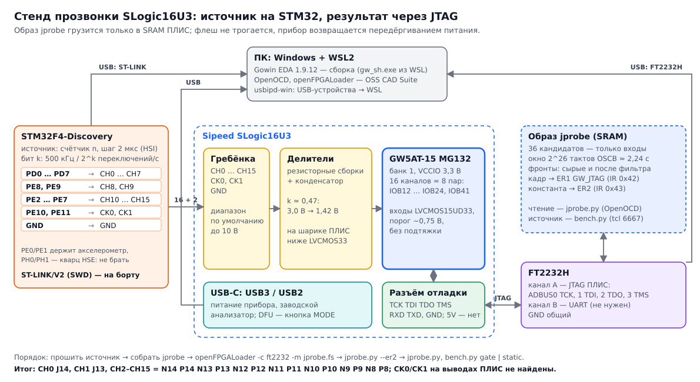

# SLogic16U3: журнал прозвонки входов

Журнал попыток по [методике](slogic-pinmap-method.md). Блоки **«Для статьи»** — повороты и находки,
из которых потом складывается рассказ «как мы к этому пришли».

## Итог

### Распиновка входов

| Канал | Шарик MG132 | Площадка | Пара | Функции вывода | Как подтверждён |
|---|---|---|---|---|---|
| CH0 | J14 | IOB41B | IOB41 | DQS1 | частота, гашение PD0 |
| CH1 | J13 | IOB41A | IOB41 | DQS1 | частота, гашение PD1 |
| CH2 | N14 | IOB12B | IOB12 | — | частота, гашение PD2 |
| CH3 | P14 | IOB12A | IOB12 | — | частота |
| CH4 | N13 | IOB14B | IOB14 | D14 | частота |
| CH5 | P13 | IOB14A | IOB14 | D15 | частота |
| CH6 | N12 | IOB16A | IOB16 | — | частота; замер делителя |
| CH7 | P12 | IOB16B | IOB16 | — | частота |
| CH8 | N11 | IOB22A | IOB22 | **GCLKT_3** | частота, гашение PE8 |
| CH9 | P11 | IOB22B | IOB22 | GCLKC_3 | частота |
| CH10 | N10 | IOB18B | IOB18 | D12 | частота |
| CH11 | P10 | IOB18A | IOB18 | D13 | частота |
| CH12 | N9 | IOB24A | IOB24 | **GCLKT_2, BPLL_T_IN0** | частота |
| CH13 | P9 | IOB24B | IOB24 | GCLKC_2, BPLL_C_IN0 | частота |
| CH14 | N8 | IOB20A | IOB20 | DQS2 | частота |
| CH15 | P8 | IOB20B | IOB20 | DQS2 | частота, гашение PE7 |
| CK0, CK1 | — | — | — | — | не найдены ни на одном из 40 GPIO |

Все 16 каналов — банк 1 (VCCIO1 = 3,3 В), каналы 2k и 2k+1 — на одной дифференциальной паре.
Ограничения — [`gw/boards/slogic16u3/slogic16u3.cst`](../gw/boards/slogic16u3/slogic16u3.cst), скелет верхнего
модуля — [`top.sv`](../gw/boards/slogic16u3/top.sv).

### Настройки входов

```
IO_PORT "ch[k]" IO_TYPE=LVCMOS15UD33 PULL_MODE=NONE;
```

- **`IO_TYPE=LVCMOS15UD33`** (или `LVCMOS12UD33`): вход с порогом ~0,75 В (~0,6 В) на банке 3,3 В.
  Перед ПЛИС стоит делитель ≈0,47 с ускоряющим конденсатором (диапазон анализатора до 10 В): 3,0 В
  на входе дают 1,42 В на шарике. С `LVCMOS33` (порог ~VCCIO/2) постоянный уровень не проходит, а
  фронты — только выбросами: сотни ложных фронтов, пропадает самый быстрый канал.
- **Не** `LVCMOS12`/`LVCMOS18`: с ними Gowin считает банк 1,2/1,8-вольтовым, а он 3,3 В — эффекта нет.
- `PULL_MODE=NONE`: у входного каскада своя утечка к земле.
- Гистерезис по умолчанию (в отчёте Gowin для UD-стандартов — NONE); фильтр помех при LVCMOS15UD33
  не понадобился (сырой счёт = отфильтрованный).
- Для целей на 1,8 В после делителя ~0,85 В — запас над 0,75 В мал: `LVCMOS12UD33` или вход по VREF
  (внутренний VREF банка 0,6/0,75/0,9/1,25/1,5 В или 36/50/64 % VCCIO, DS981 §2.3). Не проверено.
- Служебные выводы не трогать: JTAG G2 G3 J3 J2, RECONFIG_N M3 (кнопка MODE), DONE L3, READY M12,
  MODE1/0 N1 N2, флеш L13 L14 M13 K14 K13 M14. Остальные свободные выводы банков 1, 3, 4 оставлять
  по умолчанию (вход): среди них, вероятно, управление мультиплексором USB, индикатор и DC-DC.
- Внутренний генератор `OSCB` с `FREQ_MODE("210")`, `FREQ_DIV(4)` даёт ~30 МГц, не 52,5.

### Сможем ли сделать адаптер трассы на этих выводах

**По выводам — да.** Порту TPIU нужны 5 линий: TRACECLK и TRACED0–3 (STM32F407: TRACECLK 84 МГц,
данные по обоим фронтам). Из 16 входов два годятся под такт: CH12 (N9) — глобальный такт GCLKT_2 и
вход PLL BPLL_T_IN0, CH8 (N11) — GCLKT_3. Предложение (в шапке `top.sv`):

| Сигнал | Канал | Шарик |
|---|---|---|
| TRACECLK | CH12 | N9 (GCLKT_2, BPLL_T_IN0) |
| TRACED0–3 | CH8–CH11 | N11 P11 N10 P10 |
| события (PPS, триггеры) | остальные | |

Все пять — в одном банке, IDDR есть на любом GPIO, PLL на TRACECLK даёт сдвиг фазы для окна
приёма. Выводы CK для этого не нужны.

Что **не** проверено и может помешать — уже не выводы:

1. **Полоса входного каскада.** Прозвонка шла на 250 кГц. Делитель с ускоряющим конденсатором
   рассчитан на анализатор, но 84 МГц DDR и разбег задержек между каналами надо мерить: следующий
   опыт — меандр с MCO STM32 (до ~84 МГц) на CH12 и счёт в ПЛИС от PLL.
2. **Порог для целей 1,8 В** — см. выше, вход по VREF.
3. **USB3 к ПК** — главный риск направления A: USB3 у прибора идёт через SerDes Q0 и IP Gowin
   (только Gowin EDA), плюс мультиплексор VL162 у разъёма, которым, возможно, управляет ПЛИС.
   Прозвонка этого не касалась.

**Разъём на обратной стороне.** Если туда выведены MIPI M0 (D-PHY: CK + 4 линии) и M1 (C-PHY: 3
тройки), это жёсткие PHY: HS — дифференциальные SLVS с малым размахом, LP — приёмники 1,2 В до
10 Мбит/с. Порт TPIU (КМОП 1,8–3,3 В) напрямую туда не подключить. Если же туда идут
неопознанные GPIO (M8, J12, пары IOB32–IOB45 банка 1, выводы банков 3/4) — это ещё входы. Проверить
тем же образом: меандр с STM32 по очереди на площадки разъёма, `jprobe.py` покажет, появился ли он
на каком-нибудь GPIO.

## Пререквизиты

### Окружение

Всё, кроме сборки битстрима, — в WSL2 (Ubuntu, ядро 6.18 WSL2, systemd включён: `[boot]
systemd=true` в `/etc/wsl.conf`). Версии, с которыми прошла прозвонка 2026-10-25:

| Что | Версия, где | Зачем |
|---|---|---|
| Gowin EDA (Windows) | 1.9.12.04, `C:\Gowin\Gowin_V1.9.12.04_x64` | синтез и битстрим GW5AT-15: в открытом тулчейне (apycula) этого кристалла нет. `gw_sh.exe` запускается из WSL, если папка проекта на диске C: (`/mnt/c/...`) |
| OSS CAD Suite | сборка 2026-10-20, `~/.local/opt/oss-cad-suite` | `openFPGALoader` v1.2.0 (загрузка в SRAM по JTAG), `openocd` 0.12.0+dev-01523 (JTAG ПЛИС и ST-LINK) |
| Icarus Verilog | 13.0 (devel), `/usr/local/bin` | симуляция `tb.v` |
| xPack arm-none-eabi-gcc | 15.2.1, `~/.local/opt/xpack-arm-none-eabi-gcc-15.2.1-1.1` | прошивка источника на STM32 |
| Python | 3.10 + `uv` 0.11 | `jprobe.py`, `bench.py` — только стандартная библиотека; `slogic_dfu.py` — `pyusb`; извлечение текста из PDF — `pypdf` |
| usbipd-win | 5.3.0 | проброс USB-устройств в WSL |

Доступ без root: правило [`sw/udev/50-rln-trace.rules`](../sw/udev/50-rln-trace.rules) (SLogic `359f:*`);
FT2232H и ST-LINK у пользователя открывают правила PlatformIO (`99-platformio-udev.rules`).

Проброс в WSL (из Windows `bind` — один раз от администратора, `attach` — после каждого
переподключения; busid зависит от порта, смотреть `usbipd list`):

```sh
U="/mnt/c/Program Files/usbipd-win/usbipd.exe"
"$U" list
"$U" attach --wsl --busid 10-4     # FT2232H 0403:6010
"$U" attach --wsl --busid 10-1     # ST-LINK 0483:3748 (Discovery)
"$U" attach --wsl --busid 1-7      # SLogic в DFU 359f:30f1 — только для чтения флеш (slogic_dfu.py)
```

FT2232H иногда отцепляется от WSL сам (в `usbipd list` — «Shared» вместо «Attached»); лечится
повторным `attach`, образ в ПЛИС при этом остаётся.

Документация Gowin, по которой шли: DS981E (даташит GW5AT), UG983E (выводы и корпуса), UG984
(схемотехника) — в [`doc/gowin/`](gowin/); UG304 (GPIO Arora V), SUG283 (примитивы), SUG1541
(физические ограничения) — в `IDE/doc/EN` установки Gowin EDA. Таблица выводов корпуса —
`IDE/data/device/GW5AT-15B/MBGA132.json`, примитивы для симуляции — `IDE/simlib/gw5a/prim_sim.v`.

### Стенд



```
                  USB (питание, отладчик)                 USB (питание; заводской анализатор)
 ПК (WSL) ◄──────────────────────────── ST-LINK            ПК ◄──────────── SLogic16U3
    ▲                                   │ SWD                                  ▲  входы CH0–CH15, CK0, CK1, GND
    │                          STM32F4-Discovery                               │
    │                       PD0–PD7, PE2–PE11, GND ────────────────────────────┘
    │ USB                                                       отладочный разъём SLogic
    └──── FT2232H ── канал A: JTAG ─────────────────────────── TCK TDI TDO TMS GND
                     канал B: UART (не нужен для прозвонки) ── RXD TXD
```

| Discovery | SLogic | Сигнал источника |
|---|---|---|
| PD0 … PD7 | CH0 … CH7 | биты 0–7 счётчика, CHk переключается 500 кГц / 2^k раз в секунду |
| PE8, PE9 | CH8, CH9 | биты 8, 9 (PE0/PE1 держит акселерометр платы) |
| PE2 … PE7 | CH10 … CH15 | биты 10–15 |
| PE10, PE11 | CK0, CK1 | биты 16, 17 (~7,6 и ~3,8 Гц) |
| GND | GND входов | общая земля |

| SLogic, отладочный разъём | FT2232H |
|---|---|
| TCK | ADBUS0 |
| TDI | ADBUS1 |
| TDO | ADBUS2 |
| TMS | ADBUS3 |
| TXD / RXD | BDBUS1 / BDBUS0 через 1 кОм (по желанию) |
| GND | GND |
| 5V | не подключать: SLogic питается своим USB |

PH0/PH1 на Discovery — ножки кварца HSE, PH1 занят: для CK не годятся. Признак работы
источника — зелёный PD12 мигает ~1 Гц.

## Инструменты и команды

Файлы — в [`tools/slogic/jprobe/`](../tools/slogic/jprobe/), источник — [`tools/slogic/pinmap/stm32/`](../tools/slogic/pinmap/stm32/).

| Инструмент | Что делает |
|---|---|
| `jprobe.v`, `jprobe.cst`, `gowin.tcl` | образ-прозвонка: 36 входов без подтяжки (`LVCMOS15UD33`), окна 2^26 тактов OSCB (~2,24 с), счёт фронтов сырой и после фильтра 16 тактов, кадр в ER1 `GW_JTAG` (0x42), константа в ER2 (0x43) |
| `tb.v` | симуляция образа с заглушками `OSCB`/`GW_JTAG` |
| `jprobe.py` | чтение кадра через OpenOCD + FT2232H, опознание каналов по частоте |
| `bench.py` | опыты с источником через постоянный OpenOCD на ST-LINK: длина окна, гашение линий, статика, удержание уровня для замеров |
| `pinmap/stm32/main.c` | источник: счётчик на PD/PE, шаг 32 такта HSI |

Порядок сеанса:

```sh
O=~/.local/opt/oss-cad-suite/bin
J=tools/slogic/jprobe

# 0. Бэкап флеш на месте (флеш не трогаем, но путь восстановления должен быть)
sha256sum slogic16u3-factory.bin                       # 161e2bcf…85bc

# 1. Источник: сборка, прошивка, постоянный сервер OpenOCD для опытов
make -C tools/slogic/pinmap/stm32
$O/openocd -f board/stm32f4discovery.cfg -c "program tools/slogic/pinmap/stm32/pattern.elf verify reset exit"
$O/openocd -f board/stm32f4discovery.cfg -c "gdb_port disabled; telnet_port disabled; tcl_port 6667; init" &

# 2. Образ: симуляция и сборка (Gowin EDA, копия папки на диске C:)
iverilog -g2012 -o /tmp/tb $J/tb.v $J/jprobe.v && vvp -n /tmp/tb
B=/mnt/c/Users/Public/rln-jprobe; rm -rf $B; mkdir -p $B; cp $J/gowin.tcl $J/jprobe.v $J/jprobe.cst $B/
(cd $B && /mnt/c/Gowin/Gowin_V1.9.12.04_x64/IDE/bin/gw_sh.exe gowin.tcl)    # → impl/pnr/jprobe.fs
grep -E 'p\[|pad' $B/impl/pnr/jprobe.rpt.txt | head                          # направления, IO_TYPE, подтяжки

# 3. Загрузка только в SRAM и проверка канала результата
$O/openFPGALoader -c ft2232 --detect                   # GW5AT-15, IDCODE 0x0001681b
$O/openFPGALoader -c ft2232 -m $J/jprobe.fs
python3 $J/jprobe.py --er2                             # 12345678

# 4. Прозвонка
python3 $J/jprobe.py -n 2                              # первый кадр после загрузки — переходный
python3 $J/bench.py window                             # длина окна: проверка F_OSC в jprobe.py
python3 $J/bench.py gate PD0 PD1 PE8 PE10              # какой вывод замолкает
python3 $J/bench.py static                             # статика 1/0
python3 $J/bench.py hold 1                             # держать 1 для замера мультиметром; потом bench.py run

# 5. Вернуть прибор: передёрнуть питание SLogic — грузится заводское приложение из флеш
```

Варианты раскладки (другие кандидаты, другой `IO_TYPE`) — копия `jprobe.cst` с заменой строк
`IO_LOC`/`IO_PORT`, сборка в отдельной папке, чтение с `--cst`:
`python3 $J/jprobe.py --cst вариант.cst`, `python3 $J/bench.py --cst вариант.cst gate …`.

Грабли, о которые споткнулись (подробно — в записях ниже):

- `openocd … shutdown` отпускает ядро STM32 — для опытов со стоящим ядром нужен один постоянный
  сервер (`tcl_port 6667`), с ним и работает `bench.py`;
- `drscan` с несколькими полями в этой сборке OpenOCD отдаёт только первое — кадр читается одним
  полем;
- после загрузки образа проверять `jprobe.py --er2`: однажды загрузка молча не прошла, и ER1
  вернул нули;
- гашение линий — с восстановлением MODER в `finally` (`bench.py` так и делает): иначе упавший
  скрипт оставляет линию входом, и следующий опыт «теряет» канал.

## 2026-10-25. Э0: таблица выводов MG132

Источник — таблица корпуса из Gowin EDA: `IDE/data/device/GW5AT-15B/MBGA132.json` (MBGA132 = MG132);
сверено с UG983E (табл. 2-3: MG132, CS130 и CS130F — по 53 пользовательских вывода, банки 1–4 —
30/7/8/8).

**Для статьи: «не тот корпус» — не причина.** Мы объяснили неудачу первой прозвонки тем, что образ
собран под CS130, а на плате MG132. Сравнение таблиц это опровергает: у обоих корпусов **один и тот же
набор из 53 площадок кристалла** (IOB11A, IOL33B, …), только под другими именами шариков. Битстрим
настраивает площадки кристалла, а не шарики корпуса, поэтому образ под CS130 на MG132 включил ровно
те площадки, которые и хотели: все 40 свободных. Прямое доказательство — отчёт вообще записался во
флеш: SPI-мастер образа шёл на шарики H4/H5/K4/G4 CS130, это площадки IOB5B/IOB5A/IOB7B/IOB3B, они
же L13/L14/M13/K14 (MCS_N/CCLK/MOSI/MISO) у MG132. Значит, «ни одного фронта на 40 выводах» — это
правда про все 40 площадок общего назначения, и причина в другом: источник не работал или не был
подключён, либо каналы приходят не на GPIO. Урок: сверять гипотезу с данными сразу, а не после
того, как на ней построен план.

Старые имена из отчёта первой прозвонки в именах MG132:

| В отчёте (CS130) | Площадка | Шарик MG132 | Функция конфигурации | Что видели |
|---|---|---|---|---|
| D3 | IOL33B | M1 | CSI_B / SDA (банк 3) | держится в 0 снаружи |
| F7 | IOL22B | H2 | RDWR_B / SO / SSI1 (банк 4) | держится в 0 снаружи |
| K2 | IOB39A | D14 | D11 (банк 1) | держится в 0 снаружи |
| N2 | IOB45B | G14 | EMCCLK (банк 1) | держится в 0 снаружи |

### Выводы GW5AT-15 MG132

53 вывода общего назначения; остальное — SerDes Q0 (USB3), MIPI M0 (D-PHY: CK, D0–D3) и M1
(C-PHY: три тройки D0–D2 A/B/C), питание.

| Банк | Площадки | Шарики MG132 | Что на них |
|---|---|---|---|
| 1 (30) | IOB11A…IOB45B | M8 N8 P8 N9 P9 N10 P10 N11 P11 N12 P12 N13 P13 N14 P14 J12 J13 J14 G13 H13 E13 F13 C13 D13 C14 D14 E14 F14 G14 H14 | свободные; 14 пар LVDS, группы DQ1/DQ2; D08–D15 параллельной конфигурации, EMCCLK. Два вывода VCCIO1 — кандидат на 16 каналов с порогом = VCCIO1 |
| 2 (7) | IOB3A/B, IOB5A/B, IOB7A/B, IOB9A | K13 K14 L13 L14 M13 M14 M12 | флеш: MCS_N L13, CCLK L14, MOSI M13, MISO K14, D02 K13, D03 M14; READY M12 |
| 3 (8) | IOL29A/B, IOL31A/B, IOL33A/B, IOL35A/B | L3 M3 N1 N2 M1 M2 P1 P2 | DONE L3, RECONFIG_N M3 (кнопка MODE), MODE1 N1, MODE0 N2; свободные M1 M2 P1 P2 |
| 4 (8) | IOL20A/B, IOL22A/B, IOL24A/B, IOL26A/B | G2 G3 J3 J2 H2 H3 K2 K3 | JTAG: TCK G2, TMS G3, TDI J3, TDO J2; свободные H2 H3 K2 K3. Банк JTAG — 3,3 В (разъём) |

Не трогать (п. 3 правил): G2 G3 J2 J3, M3, L3, M12, N1 N2, L13 L14 M13 K14, K13 M14 — 15 выводов.
Кандидаты прозвонки — 38: весь банк 1 (30), M1 M2 P1 P2 (банк 3), H2 H3 K2 K3 (банк 4).

**Для статьи: MIPI-ножки — не запасной вариант.** 19 выводов MIPI (M0_*, M1_*) по числу похожи на
«16 каналов + CK», но это жёсткие D-PHY/C-PHY: приёмник LP-режима на 1,2 В, обычного входа
LVCMOS нет; режим «MIPI IO» в DS981 (§2.10.2) относится к GPIO, а не к этим ножкам. Входы
анализатора с резисторными сборками и порогом через напряжение банка ложатся на банк 1.

## 2026-10-25. Состояние прибора перед опытами

SLogic в DFU (`359f:30f1`, видимо, после MODE). Флеш: JEDEC `0b4018`, 0x0..0xFFFF совпадает с
`slogic16u3-factory.bin` (sha256 бэкапа `161e2bcf…85bc` сверен). FT2232H подключён к JTAG-разъёму;
OpenOCD 0.12+dev (OSS CAD Suite) видит TAP `0x0001681b`, IR 8 бит. ST-LINK в WSL не проброшен
(`usbipd bind` нужен от администратора), поэтому STM32 этим днём не перешивался и не сбрасывался.

Э1 (запись заводским анализатором) **не проводилась**: прибор был в DFU, а заводской приёмник по
USB3 в WSL не проверить. Что источник работает и подключён, показала сама прозвонка (ниже).

## 2026-10-25. Э2: результат через пользовательский JTAG

Образ [`tools/slogic/jprobe`](../tools/slogic/jprobe/): только входы без подтяжки, ни одного
выхода, кроме TDO самого JTAG. Результат — регистр ER1 примитива `GW_JTAG` (инструкция 0x42),
проверочная константа `0x12345678` — ER2 (0x43). Читает [`jprobe.py`](../tools/slogic/jprobe/jprobe.py)
через OpenOCD, грузит образ `openFPGALoader -c ft2232 -m jprobe.fs` (только SRAM).

**Для статьи: три грабли `GW_JTAG` у Gowin EDA 1.9.12.04 на GW5A.**

1. Оставить выводы `*_pad_*` примитива неподключёнными (так советуют для Tang Nano 20K) — синтез
   выкидывает примитив вместе со всей логикой: 0 регистров в отчёте, предупреждение `Input p is
   unused`. Рабочий способ подсмотрен в LiteX (`GowinJTAG`): порты верхнего уровня с **именно
   такими** именами `tck_pad_i`, `tms_pad_i`, `tdi_pad_i`, `tdo_pad_o`, и **без** строк в `.cst` —
   размещение само сажает их на G2/G3/J3/J2.
2. Эти четыре порта Gowin считает в лимит обычных I/O (40 при всех двойных выводах в режиме GPIO,
   ошибка PA2024). Поэтому кандидатов в одном образе — не 38, а 36; K2/K3 прозвонены вторым образом.
3. В Capture-DR и Shift-DR у примитива один сигнал `shift_dr_capture_dr_o`. В симуляции казалось, что
   такт захвата съест бит 0, и в образ была заложена поправка; на железе вышло наоборот — первым
   пришёл лишний бит (ER2 `2468acf0` = `12345678`<<1). Поправку убрали, а начало кадра читалка ищет
   по метке `RLNJ` — с меткой порядок бит можно не угадывать.

Ещё мелочь: `drscan` OpenOCD с несколькими полями (`32 0 32 0 …`) вернул только первое; одно поле
на весь кадр (`drscan tap 2400 0`) отдаёт всё одним hex-числом.

Первая загрузка: ER2 прочитан, кадр ER1 пришёл с меткой и совпавшими seq в начале и конце —
канал результата работает. Заводской образ после этого возвращается передёргиванием питания
(флеш не трогали).

## 2026-10-25. Э3: прозвонка входов

Образ `jprobe.fs` v2 (sha256 `dcd73483…1882`), корпус `GW5AT-LV15MG132C1/I0`, ревизия B,
окно 2^26 тактов OSCB (≈1,28 с), 36 кандидатов. Источник — `tools/slogic/pinmap/stm32`, был
подключён и работал (зелёный PD12 не проверялся — Discovery не на глазах, но каналы видны).

### Первая версия образа (только счёт фронтов)

PD1–PD6 — идеально: соседние каналы ровно в 2 раза, от окна к окну ±0,05 %. PD7 и все PE —
«не наш меандр»: счёт выше ожидаемого и гуляет на ±3 %.

**Для статьи: дребезг, а не неверная проводка.** Во второй версии образа рядом со «сырым» счётчиком
поставлен счётчик после фильтра: уровень засчитывается, если продержался 16 тактов (≈300 нс). С
фильтром все медленные каналы встали точно на целые k, а разница «сырой − фильтр» оказалась
**почти одинаковой на всех медленных линиях, ~750–850 за окно, независимо от их частоты**. Значит,
это наводка (вероятно, земля/перекрёстные помехи на длинных проводах от одновременного
переключения младших бит), а не сигнал. Почему быстрые линии (PD1–PD6) почти не страдают, пока
не ясно — проверить осциллографом. Вывод для своей прошивки:
на входах нужен фильтр или гистерезис (у GW5A для LVCMOS33 он есть, `HYSTERESIS` в `.cst`), иначе
медленные сигналы с длинных проводов дадут ложные фронты.

Ещё одна поправка: измеренная частота всех каналов — 0,872 от расчётной (внутренний генератор
ПЛИС и HSI STM32 врут на проценты). Читалка сама находила эту поправку по медиане дробной части
log2 у чистых каналов — и именно это спрятало ошибку на целую октаву (ниже).

### Результат (два кадра подряд, совпадают) — НЕВЕРНЫЕ МЕТКИ, см. ниже «Сдвиг на октаву»

| Канал | Вывод STM32 | Шарик MG132 | Площадка | Фронтов за окно |
|---|---|---|---|---|
| CH0 | PD0 | **не найден** | — | ожидалось ~557 тыс. |
| CH1 | PD1 | N14 | IOB12B | 278 792 |
| CH2 | PD2 | P14 | IOB12A | 139 398 |
| CH3 | PD3 | N13 | IOB14B | 69 698 |
| CH4 | PD4 | P13 | IOB14A | 34 850 |
| CH5 | PD5 | N12 | IOB16A | 17 426 |
| CH6 | PD6 | P12 | IOB16B | 8 714 |
| CH7 | PD7 | N11 | IOB22A | 4 358 |
| CH8 | PE0 | P11 | IOB22B | 2 178 |
| CH9 | PE1 | N10 | IOB18B | 1 090 |
| CH10 | PE2 | P10 | IOB18A | 546 |
| CH11 | PE3 | N9 | IOB24A | 272 |
| CH12 | PE4 | P9 | IOB24B | 136 |
| CH13 | PE5 | N8 | IOB20A | 68 |
| CH14 | PE6 | P8 | IOB20B | 34 |
| CH15 | PE7 | **не найден** | — | ожидалось ~17 |

Все 14 найденных — банк 1, семь дифференциальных пар IOB12…IOB24 подряд; внутри пары каналы
соседние. (Подписи PE0/PE1 у CH8/CH9 — ошибка читалки: провода стоят на PE8/PE9, прошивка дублирует туда
биты 8 и 9; PE0/PE1 — входы, их держит акселерометр, MODER_E = `00055550`.)

Без фронтов: в 1 — M8 (IOB11A), J12 (IOB31A), H13 G13 (IOB32), F13 E13 (IOB34), D13 C13 (IOB36),
F14 (IOB43A), H14 (IOB45A); в 0 — D14 C14 (IOB39), J14 (IOB41B), E14 (IOB43B), G14 (IOB45B),
M1 M2 P1 P2 (банк 3), H2 H3 K2 K3 (банк 4). J13 (IOB41A) — нерегулярные 120–180 фронтов за окно
после фильтра: не меандр источника; кандидат на вывод CK гребёнки или незанятый вход с наводкой.

Первый кадр после загрузки образа — переходный: на свободных выводах десятки тысяч ложных фронтов,
со второго окна — тишина. Читать со второго кадра (seq ≥ 2).

**Для статьи: почему первая прозвонка (2026-10-21) не увидела ничего.** Сегодня те же площадки
(раскладка CS130 включала их все) переключаются как положено. Значит, 21 октября источник не был
подключён или не работал — других объяснений не осталось: корпус, подтяжки и multiboot отпали
(в заголовке битстрима по 0x4C у старого `pinmap` тот же multiboot `0x800000`, что у `probe`).

### Что осталось (устарело — см. «Сдвиг на октаву»)

- CH0 и CH15: ни на одном из 38 GPIO. Самая простая версия — на стенде не подключены провода PD0 →
  CH0 и PE7 → CH15 (крайние в обоих рядах). Красивая версия — это два одиночных вывода банка 1,
  M8 (IOB11A) и J12 (IOB31A): оба стабильно в 1. Проверить проводку, затем повторить (п. 4 методики:
  отключать каналы по одному).
- Э3 п. 1 (фон с источником в сбросе) — нужен ST-LINK в WSL.
- Э4: CK и порог. Напряжение банка 1 мультиметром не мерили; LVCMOS33 на входах сигнал 3,3 В
  принимает.

## 2026-10-25, позже. Сдвиг на октаву, гашение линий, статика

ST-LINK проброшен в WSL. Один постоянный сервер OpenOCD (`tcl_port 6667`) держит STM32; команды —
через Tcl-сокет. Отдельные запуски `openocd … shutdown` отпускали ядро, и прошивка снова бежала —
первая «бегущая единица» поэтому дала мусор.

**Для статьи: автоподстройка, которая прячет ошибку.** Пользователь спросил: как я прозвонил CH8/CH9
на PE0/PE1, если провода давно на PE8/PE9? Подписи — из жёсткого списка в читалке, это полбеды. Но
проверка пошла дальше. Длина окна, засечённая по смене seq, — **2,24 с, а не 1,28 с**: OSCB с
`FREQ_MODE("210")`, `FREQ_DIV(4)` на GW5AT-15 даёт ~30 МГц, а не 52,5. Множитель ошибки 0,57;
вместе с «поправкой» 0,872 это ровно 0,5 — **одна октава**. Читалка подгоняла дробную часть log2 и
честно округляла к соседнему целому: все каналы уехали на единицу, а картинка выглядела идеально
(k = 1,00; 2,00; …). Поймало это независимое измерение: PD1 переведён во вход прямо на работающей
прошивке (MODER, прошивка его не трогает) — а «CH1» на N14 продолжает считать как ни в чём не
бывало. С F_OSC = 2^26 / 2,24 с поправка стала 0,998: источник идёт на расчётных 500 кГц. Урок:
частоту опорного генератора — мерить, а не брать из параметров примитива; любую подгонку —
проверять опытом, который от неё не зависит.

### Гашение линий (п. 4 методики)

STM32 работает, одна линия переводится во вход (MODER), смотрим, какой вывод ПЛИС замолчал:

| Погашено | Что изменилось |
|---|---|
| PD2 | замолчал N14 |
| PE8 | замолчал N11 |
| PE7 | замолчал P8 |
| PD1 | замолчал J13 (там было ~190 случайных фронтов) |
| PD0 | на J13 — **559 тыс. фронтов, ровно бит 1**, J14 тихий |

**Для статьи: CH1 «глушит» CH0.** Пока бежит PD0 (250 кГц), на J13 вместо CH1 — сотня случайных
фронтов за окно; стоит погасить PD0 — CH1 чистый. Пара IOB41A/B (J13/J14) — это CH1/CH0: соседние
ножки одной пары, соседние провода. Сам CH0 (250 кГц) до ПЛИС не доходит ни в каком режиме.

### Исправленная раскладка

| Канал | Шарик | Площадка | Как подтверждён |
|---|---|---|---|
| CH0 | J14? | IOB41B? | не виден; пара к CH1 |
| CH1 | J13 | IOB41A | частота при погашенном PD0, гашение PD1 |
| CH2 | N14 | IOB12B | частота, гашение |
| CH3 | P14 | IOB12A | частота |
| CH4 | N13 | IOB14B | частота |
| CH5 | P13 | IOB14A | частота |
| CH6 | N12 | IOB16A | частота |
| CH7 | P12 | IOB16B | частота |
| CH8 | N11 | IOB22A | частота, гашение PE8 |
| CH9 | P11 | IOB22B | частота |
| CH10 | N10 | IOB18B | частота |
| CH11 | P10 | IOB18A | частота |
| CH12 | N9 | IOB24A | частота |
| CH13 | P9 | IOB24B | частота |
| CH14 | N8 | IOB20A | частота |
| CH15 | P8 | IOB20B | частота, гашение PE7 |

Восемь пар банка 1: каналы 2k и 2k+1 — на одной паре.

### Статика не проходит

STM32 остановлен, PD0–PD7 и PE2–PE9 в 1 (IDR = ODR = `ff`) — **на всех каналах ПЛИС читает 0**;
то же при всех линиях в 0. Пробовал стандарты банка 1: LVCMOS33, LVCMOS18, LVCMOS12 — разницы нет.
Медленные ручные переключения линии (8 раз по 150 мс) тоже не дают ни одного фронта на ПЛИС, а
при погашенном выходе ножка STM32 читается как 0 — на входе прибора есть утечка к земле.

Версия: вход — делитель с ускоряющим конденсатором (как в щупе осциллографа). Постоянный уровень
после делителя ниже любого из опробованных порогов, а на фронте через конденсатор проходит выброс:
отсюда точный счёт фронтов при работающем источнике, нули в статике, «дребезг» и потеря самого
быстрого канала. Как тогда работает заводской анализатор с порогом? В UG304 у GW5A есть входы с
опорным напряжением (`VREF`, в том числе внутренний генератор, стандарт `VREF1_DRIVER`) и
`THRESHOLD_OFFSET` (+100 мВ). Скорее всего, Sipeed ставит порог через VREF — это следующий опыт.

Нужно от железа: напряжение VCCIO1 и постоянное напряжение на шарике (или на ПЛИС-стороне
резистора) канала, когда STM32 держит на нём 1. Это сразу покажет коэффициент делителя.

### CK

Пользователь подключил CK0 → PH0, CK1 → PH1. На Discovery это ножки кварца HSE. Проверка
подтяжками: PH0 свободен, **PH1 держит кто-то** (0 при подтяжке и вверх, и вниз) — выходом не
трогал. PH0 в «бегущей единице» ничего на ПЛИС не сдвинул, но статика, как выяснилось, не проходит
вообще — CK искать надо меандром. Пользователь готов перенести CK на другие выводы.

### CK на PE10/PE11

Прошивка `stm32` дополнена: биты 16 и 17 счётчика (~7,6 и ~3,8 Гц, ~17 и ~8,5 фронтов за окно)
на PE10/PE11; пользователь перенёс CK0 → PE10, CK1 → PE11. Темп источника не изменился (поправка
0,999). **Ни на одном из 38 свободных выводов CK не виден** (основной образ и вариант с K2/K3).
Не прозвонены только служебные: MODE1/MODE0 (N1/N2 — это пара GCLKT_5/GCLKC_5, естественное место
для двух тактовых входов), READY M12, DONE L3, D02/D03 K13/M14 (IO2/IO3 флеш). MODE-выводы
читаются ПЛИС только в начале конфигурации; вход без подтяжки на них после загрузки безвреден, но по
п. 3 правил методики их не трогаем без отдельного решения.

### Статика: версия пользователя

По умолчанию диапазон входов анализатора — 0…10 В, значит, делитель примерно 1:3, и 3,3 В после
него ~1 В — ниже порога LVCMOS33 (~1,5 В при VCCIO 3,3 В). Опыт с LVCMOS12 (порог ~0,6 В) этого не
исправил: похоже, порог приёмника задаёт само напряжение VCCIO1, а не `IO_TYPE`, или заводской
образ ставит порог через VREF. Замер: STM32 остановлен, все линии каналов и CK в 1 (IDR_D `50ff`,
IDR_E `0ffc`), пользователь меряет постоянное напряжение на выходе делителей.

## 2026-10-25, вечер. Порог: всё дело в стандарте входа

Замер пользователя: на входе канала (около CH6) 3,0 В, на выходе делителя — **1,42 В** (≈0,47).
По умолчанию диапазон входов — до 10 В, отсюда и делитель. Порог LVCMOS33 — около половины VCCIO,
~1,5–1,65 В: 1,42 В его не достают.

**Для статьи: «LVCMOS12» и «LVCMOS12UD33» — разные вещи.** Первый опыт с низким порогом
(LVCMOS12, LVCMOS18 на банке 1) ничего не дал — и это ввело в заблуждение. В отчёте Gowin при
LVCMOS12 у банка стоит VCCIO 1,2 В: САПР «перевела» банк на 1,2 В и настроила приёмник под это, а
на плате VCCIO1 — 3,3 В. В DS981 (табл. 2-8) для GW5AT-15 есть «under-drive» стандарты:
`LVCMOS10UD33`, `LVCMOS12UD33`, `LVCMOS15UD33`, … — сигнал низкого уровня на банке 3,3 В. С ними:

| Банк 1 | Каналы при работающем источнике | Статика 1/0 | CH0 |
|---|---|---|---|
| LVCMOS33 | 14 из 16, сотни ложных фронтов | всегда 0 | не виден, CH1 забит |
| LVCMOS18, LVCMOS12 | как LVCMOS33 | всегда 0 | — |
| `LVCMOS12UD33`, `LVCMOS15UD33` | **16 из 16, сырой счёт = после фильтра** | **1/0 как у STM32** | J14 |
| `SSTL33_I`, VREF INTERNAL по умолчанию | 16, но есть шум | всегда 0 | J14 |

Так «необъяснимые» наблюдения дня сложились в одно: точный счёт при «невидимой» статике —
выбросы на фронтах через ускоряющий конденсатор делителя; «дребезг» на медленных линиях — фронт,
медленно уходящий ниже порога; потеря CH0 и помеха CH0 → CH1 — у самого быстрого канала выброс
меньше. Основной `jprobe.cst` теперь на `LVCMOS15UD33` (`jprobe.fs` sha256 `019b9445…0a3c`).

### Итог: распиновка входов

CH0 J14, CH1 J13, CH2 N14, CH3 P14, CH4 N13, CH5 P13, CH6 N12, CH7 P12, CH8 N11, CH9 P11, CH10 N10,
CH11 P10, CH12 N9, CH13 P9, CH14 N8, CH15 P8 — все банк 1, пары IOB41, IOB12, IOB14, IOB16, IOB22,
IOB18, IOB24, IOB20 (каналы 2k, 2k+1 на одной паре). Гашением подтверждены CH0, CH1, CH2, CH8, CH15.

### CK

Меандр 7,6 и 3,8 Гц на PE10/PE11 (CK0/CK1) — ни на одном из 40 выводов (36 основных + K2, K3,
N1, N2 с низким порогом). M2, P2, P1, H3, C14, E14 «висят»: их уровень меняется от образа к образу,
от STM32 не зависит. N1/N2 (MODE1/0) стабильно в 1 — подтяжки выбора режима. Не проверены READY,
DONE и IO2/IO3 флеш. Версии: CK до ПЛИС не разведены (Sipeed: «зарезервированы, не реализованы»)
или идут на ножки, которые не бывают GPIO (REFCLK SerDes, MIPI).

**Для статьи: грабли собственного стенда.** Скрипт гашения упал на чтении кадра, когда образ ещё не
загрузился, и не вернул PD0 в режим выхода. Следующий опыт показал «пропавший» CH0 на том же образе,
где он только что был; разгадка нашлась в MODER_D = `11005554`. Теперь восстановление — в `finally`.
