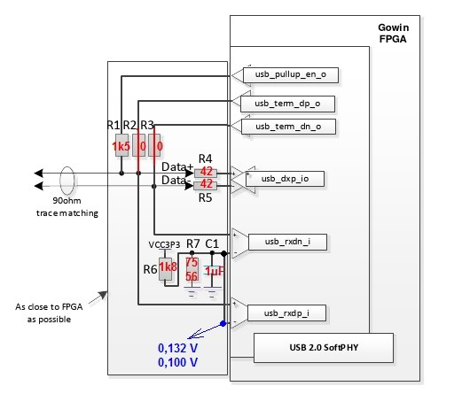
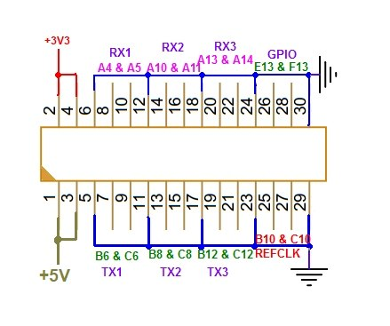

# tools/slogic — флеш ПЛИС SLogic16U3

Направление A: своя прошивка (адаптер трассы) для Sipeed SLogic16U3. Здесь — доступ к
конфигурационной флеш через режим обновления и проверка, примет ли ПЛИС свой битстрим.

## Что известно

По открытым исходникам Sipeed ([SLogic](https://github.com/sipeed/SLogic),
[slogic_ota_server](https://github.com/sipeed/slogic_ota_server)) и дампу флеш прибора:

- Триггер по фронтам — программный, на ПК (`slogic_trigger_scan` в `slogic_data.c`); ПЛИС только
  непрерывно льёт выборки.
- Режим обновления (кнопка MODE, USB2, `359f:30f1`) — мост USB-SPI к флеш ПЛИС.
- Флеш 16 МиБ, JEDEC ID `0b4018`. Два образа:

| Адрес | Размер | Что |
|---|---|---|
| `0x000000` | 595 КиБ | приложение (логический анализатор, USB3) — первая загрузка |
| `0x800000` | 349 КиБ | золотой образ = загрузчик DFU (USB2) |

- Оба образа **зашифрованы** AES-128: после преамбулы `FF… DE DE DE DE FF…` синхрослово `A5 DB`
  вместо `A5 C3` у открытого битстрима, энтропия ~8 бит/байт, у обоих одинаковый хвост — ключ общий.
  Прочитать или поправить заводской дизайн нельзя.
- GW5A грузит образ с `0x800000` сам, если загрузка с `0x0` не удалась (ошибка ID, CRC, команды,
  таймаут; UG704 §3.6.3). Поэтому затирание `0x0` прибор не убивает, пока цел золотой образ.
- Ключ AES «не влияет на незашифрованные битстримы» (UG704 §4.4.2), если не прожжён eFuse
  `cfg_aes_only` (бит 96 OTP). **Sipeed его не прожёг**: свой открытый битстрим ПЛИС грузит
  (опыт ниже).
- **Кнопка MODE разведена на RECONFIG_N.** Пустой образ без логики по нажатию MODE ушёл в DFU — это
  мог сделать только аппаратный перезапуск конфигурации с адреса multiboot из нашего битстрима
  (`0x800000`). Внутренняя логика RECONFIG_N дёрнуть не может, поэтому у 16U3 нет переключения
  режима по USB, как у 32U3. Следствие для своей прошивки: прибор всегда возвращается в DFU
  кнопкой, если в образе задан multiboot на `0x800000` (`-multi_boot 1`, см. `probe/gowin.tcl`).

## Плата

Осмотр 2026-10-25 (корпус вскрыт):

| Компонент | Маркировка | Что это |
|---|---|---|
| ПЛИС | GW5AT-LV15MG132C1/I0 | Gowin Arora V, 15K LUT, корпус MG132 |
| Флеш | XT25F128F | XTX, 128 Мбит = 16 МиБ, JEDEC `0b4018` (0x0B — XTX); openFPGALoader её не знает |
| У разъёма Type-C | L162, Q965 040 | вероятно VIA Labs VL162 — мультиплексор 2:1 пар SuperSpeed под ориентацию кабеля; чем выбирается сторона (сам по CC или выводом ПЛИС), не известно |
| С обратной стороны | T70030 | вероятно TMI7003 — тройной понижающий DC-DC (тот же стоит на Tang Nano 9K); питание ядра и банков |
| Входы | 4 резисторные сборки (?), конденсатор, диод | только пассивные компоненты: буферов и компараторов нет, каналы идут на выводы ПЛИС через последовательные резисторы. Порог, видимо, — напряжение банка ввода-вывода от DC-DC |
| Отладочный разъём | `5V TMS TDO TCK TDI RXD TXD GND` | JTAG ПЛИС и UART, 3,3 В, см. ниже |

### Выводы ПЛИС по прозвонке платы (vik-mva-lab, 2026-11)

vik-mva-lab снял ПЛИС с платы и прозвонил площадки под ней. Это прямое подтверждение того, что мы
находили опытами (входы, D14, D13, SoftPHY), и ответы на открытые вопросы: CK0/CK1, вывод M12,
неразведённый разъём с линиями SerDes.

| Шарик | Что | Подробности |
|---|---|---|
| J14 J13 N14 P14 N13 P13 N12 P12 | IN0..IN7 | как у нас (CH0..CH7) |
| N11 P11 N10 P10 N9 P9 N8 P8 | IN8..IN15 | как у нас (CH8..CH15) |
| **H13** | CLK0 (CK0 гребёнки) | через 33 Ом |
| **G13** | CLK1 (CK1 гребёнки) | через 33 Ом |
| G14 | красный светодиод | 1 — горит |
| M12 | сине-зелёный светодиод | 0 — горит синий; через транзисторную сборку SOT-363 (вывод 2) |
| L3 | DONE | на ту же сборку SOT-363 (вывод 5), индикация: 0 — ошибка конфигурации |
| M3 | RECONFIG_N | соединён с **D13** и кнопкой MODE (USER); подтяжка 5,1 кОм к 3,3 В, кнопка на GND |
| N2 | MODE0 | 1 кОм к 3,3 В |
| N1 | MODE1 и **GCLK 125 МГц** | 1 кОм к 3,3 В; на тот же вывод заведён несимметричный такт 125 МГц |
| D14 | OSC_CLK_ON | разрешение генератора 125 МГц, подтяжка 1,8 кОм к питанию |
| A7 A8 | 125 МГц, дифф. | REFCLK SerDes |
| A1 A2, B3 C3 | USB SuperSpeed | линия SerDes, через мультиплексор ориентации |
| M8 | неизвестно | куда-то уходит; возможно, выбор стороны мультиплексора SS |
| F14 / E14 | TXD / RXD | UART отладочного разъёма |
| M13 K14 L14 L13 K13 M14 | флеш MOSI MISO CLK CS WP HOLD | CLK — 1 кОм к GND; CS, WP, HOLD — 5,1 кОм к 3,3 В |

Выводы, которые мы искали прозвонкой и не нашли:

- **CK0/CK1 — H13/G13**, пара IOB32 банка 1. В опыте 2026-10-25 оба стояли в 1 и меандр 7,6/3,8 Гц с
  PE10/PE11 не показали ([журнал](../../doc/slogic-pinmap-journal.md#ck)). Последовательный 33 Ом без
  делителя — значит, порог там другой, чем у каналов. Перепроверить на стенде.
- **D13 = RECONFIG_N**: то самое «D13 в 0 перезапускает ПЛИС» из опытов с USB2 — это провод на M3.
- **125 МГц на N1** (MODE1, GCLKT_5): обычный глобальный такт от того же генератора, а не только через
  `tx_pcs_clkout` SerDes. После конфигурации MODE1 — обычный вход; подтяжка 1 кОм нагружает генератор,
  но фронты должны пройти. Тоже проверить.

**USB 2.0 SoftPHY** — разведён по схеме Gowin (рисунок vik-mva-lab, номиналы — с этой платы):



- C14 `usb_pullup_en_o` — через 1,5 кОм на D+;
- D+: H3 `usb_rxdp_i`, P2 `usb_term_dp_o`, через 100 Ом на K3 `usb_dxp_io`;
- D−: M2 `usb_rxdn_i`, P1 `usb_term_dn_o`, через 100 Ом на K2 `usb_dxp_io`;
- H2 и M1 (N-половины приёмников) соединены вместе и сидят на делителе 1,8 кОм / 56 Ом от 3,3 В с 1 мкФ:
  опорное **~0,10 В** (у Gowin в примере 75 Ом — 0,13 В).

Совпадает с раскладкой из ciniml, по которой работает наш HS ([журнал USB](../../doc/slogic-usb-journal.md)).

**Неразведённый разъём на 30 контактов: SerDes наружу.** На плате есть место под разъём, к нему идут
три оставшиеся линии квада SerDes и его второй REFCLK — то есть путь к PCIe или другому быстрому
последовательному интерфейсу:



| Контакты | Что | Шарики |
|---|---|---|
| 1, 3 | +5 В | — |
| 2, 4 | +3,3 В | — |
| 7, 9 | TX1 | B6, C6 |
| 8, 10 | RX1 | A4, A5 |
| 13, 15 | TX2 | B8, C8 |
| 14, 16 | RX2 | A10, A11 |
| 19, 21 | TX3 | B12, C12 |
| 20, 22 | RX3 | A13, A14 |
| 25, 27 | REFCLK | B10, C10 |
| 26, 28 | GPIO | E13, F13 (пара IOB34 банка 1) |
| 5, 11, 17, 23, 29; 6, 12, 18, 24, 30 | GND | — |

Каждая пара отделена землёй с обеих сторон. Какие протоколы и скорости тянет SerDes GW5AT-15 на
этих линиях — смотреть DS981; это кандидат на PCIe-вариант адаптера трассы и на быстрый порт без
жгута анализатора.

## Утилита

```sh
pip install pyusb                      # + udev-правило 359f:30f1, см. README прошивальщика Sipeed
python3 tools/slogic/slogic_dfu.py id
python3 tools/slogic/slogic_dfu.py dump slogic16u3-factory.bin
python3 tools/slogic/slogic_dfu.py write образ.bin --backup slogic16u3-factory.bin
python3 tools/slogic/slogic_dfu.py restore slogic16u3-factory.bin
python3 tools/slogic/slogic_dfu.py --ftdi ftdi://ftdi:2232h/1 id   # флеш напрямую, FT2232H (pyftdi)
```

`write` и `restore` стирают всю область `0x000000..0x7fffff`, пишут, сверяют. В `0x800000` и выше
не пишут никогда. Перед записью сверяют золотой образ во флеш с бэкапом — чужой дамп не пройдёт.
Дампы (`*-factory.bin`) в git не попадают.

## Опыт: грузит ли ПЛИС открытый битстрим

[`probe/probe.bin`](probe/) — пустой открытый образ (ни одного выхода), multiboot на `0x800000`.
Собирается `gw_sh gowin.tcl` в копии папки `probe/`. Ревизии кристалла A и B дают один и тот же
битстрим.

1. Бэкап уже снят: `slogic16u3-factory.bin`, sha256 `161e2bcf…85bc`.
2. MODE → DFU, `write tools/slogic/probe/probe.bin --backup slogic16u3-factory.bin`.
3. Отключить и подключить прибор, смотреть `lsusb` и индикатор:

| Что видно | Значит |
|---|---|
| Сразу DFU `30f1`, красный мигает | открытый образ отвергнут (скорее всего `cfg_aes_only`) — своя прошивка без ключа невозможна |
| Ничего не появилось, индикатор не горит | открытый образ загружен — путь открыт |

4. Вернуть прибор:
   - если сразу DFU — `restore slogic16u3-factory.bin`;
   - если ничего — нажать MODE (ожидаем DFU через multiboot), затем `restore`.

### Результат, 2026-10-21

| Шаг | Что было |
|---|---|
| `write probe.bin` | стирание 128 блоков, запись 491 882 байт (~19 КиБ/с, пакеты по 12 байт), сверка прошла |
| Переподключение | DFU нет, индикатор горит **синим** (у заводского приложения голубой, у DFU мигает красный). Синий — вероятно, подтяжки незанятых выводов, в образе выходов нет |
| MODE | прибор ушёл в DFU `30f1` |
| `restore` | заводское приложение вернулось, прибор работает как анализатор |

Вывод: свой открытый битстрим на SLogic16U3 работает, выход в DFU — кнопкой MODE, восстановление —
`restore` из дампа. JTAG ПЛИС для этого не нужен.

## Прозвонка выводов

Образ-прозвонка, источник сигналов на STM32F4-Discovery и разбор отчёта — [`pinmap/`](pinmap/).

**2026-10-21: после записи `pinmap.bin` прибор не возвращается в DFU** (USB2 не поднимается, Windows
видит `0000:0002`). Отчёт не прочитан. Следующий шаг — вскрыть прибор и читать флеш напрямую через
FT2232H: `slogic_dfu.py --ftdi ftdi://ftdi:2232h/1 …` (pyftdi), план — в
[`pinmap/README.md`](pinmap/README.md#восстановление-следующий-шаг).

Урок для своих образов: до записи нужен путь восстановления, не зависящий от DFU (JTAG ПЛИС или
доступ к флеш), а подтяжки на неизвестных выводах могут помешать USB-части прибора.

`pinmap` и `probe` собраны под корпус CS130 (`GW5AT-LV15CS130C1/I0`), а на плате MG132. Причиной
неудачи это **не** оказалось: у CS130 и MG132 один и тот же набор из 53 площадок кристалла, битстрим
настраивает площадки, и образ включил ровно все 40 свободных. 2026-10-25 те же площадки при работающем
источнике переключаются — значит, 21 октября не работал или не был подключён источник. Разбор — в
[журнале](../../doc/slogic-pinmap-journal.md).

### Распиновка входов (2026-10-25, образ [`jprobe/`](jprobe/))

Прозвонка по [методике](../../doc/slogic-pinmap-method.md): только SRAM, входы без подтяжки, результат
через пользовательский JTAG.

| Канал | Шарик MG132 | Площадка | Банк |
|---|---|---|---|
| CH0 | J14 | IOB41B | 1 |
| CH1 | J13 | IOB41A | 1 |
| CH2 | N14 | IOB12B | 1 |
| CH3 | P14 | IOB12A | 1 |
| CH4 | N13 | IOB14B | 1 |
| CH5 | P13 | IOB14A | 1 |
| CH6 | N12 | IOB16A | 1 |
| CH7 | P12 | IOB16B | 1 |
| CH8 | N11 | IOB22A | 1 |
| CH9 | P11 | IOB22B | 1 |
| CH10 | N10 | IOB18B | 1 |
| CH11 | P10 | IOB18A | 1 |
| CH12 | N9 | IOB24A | 1 |
| CH13 | P9 | IOB24B | 1 |
| CH14 | N8 | IOB20A | 1 |
| CH15 | P8 | IOB20B | 1 |

Все 16 — банк 1, каналы 2k и 2k+1 на одной дифференциальной паре. Каждый подтверждён по частоте
меандра; CH0, CH1, CH2, CH8, CH15 — ещё и гашением линии на STM32. Статика проходит: STM32 держит
1 — ПЛИС читает 1, держит 0 — читает 0.

**Порог.** На входах — делители: из 3,0 В на выходе 1,42 В (замер пользователя на CH6, ≈0,47;
по умолчанию диапазон анализатора — до 10 В). Это ниже порога LVCMOS33 (~половина VCCIO), и с
LVCMOS33 проходят только выбросы на фронтах: точный счёт у медленных каналов, сотни ложных фронтов,
CH0 теряется, статика читается 0. Нужен вход с низким порогом на банке 3,3 В: `LVCMOS15UD33` или
`LVCMOS12UD33` — тогда всё чисто. Просто `LVCMOS12`/`LVCMOS18` не годятся: Gowin считает банк
1,2/1,8-вольтовым, на деле VCCIO1 — 3,3 В. `SSTL33_I` с внутренним VREF по умолчанию тоже не
помог. У банка есть внутренние VREF 0,6/0,75/0,9/1,25/1,5 В и 36/50/64 % VCCIO — вероятно, через
них Sipeed и регулирует порог.

**CK0/CK1** (меандр 7,6 и 3,8 Гц с PE10/PE11) не виден ни на одном из 40 проверенных выводов
(все свободные + MODE0/MODE1). Не проверены READY, DONE, IO2/IO3 флеш; возможно, CK до ПЛИС не
разведены («зарезервированы» у Sipeed). **Поправка 2026-11:** по прозвонке платы CK0/CK1 идут на
H13/G13 через 33 Ом (см. «Выводы ПЛИС по прозвонке платы») — почему опыт их не увидел, ещё выяснять.

## JTAG ПЛИС: путь восстановления без DFU (проверен 2026-10-25)

На плате есть разъём jst SH-1.0 на 8 контактов: `5V TMS TDO TCK TDI RXD TXD GND`. Это JTAG GW5AT и UART;
уровни 3,3 В. 5V не подключать — прибор питается своим USB.

| Разъём SLogic | FT2232H |
|---|---|
| TCK | ADBUS0 |
| TDI | ADBUS1 |
| TDO | ADBUS2 |
| TMS | ADBUS3 |
| TXD | BDBUS1 (UART канала B, `/dev/ttyUSB1`) |
| RXD | BDBUS0, лучше через 1 кОм |
| GND | GND |

openFPGALoader v1.2.0 (OSS CAD Suite):

```sh
O=~/.local/opt/oss-cad-suite/bin
$O/openFPGALoader -c ft2232 --detect             # GW5AT-15, IDCODE 0x0001681b
$O/openFPGALoader -c ft2232 --detect -f          # флеш 0b4018 через ПЛИС (SRAM ПЛИС стирается)
$O/openFPGALoader -c ft2232 --dump-flash --file-size 9437184 after-pinmap.bin   # 0x0..0x8FFFFF
```

Чтение работает. Запись (`-f -o 0x0 --file-type bin`) **стирает** сектора, а потом падает на
`write en: Error` — флеш XT25F128F (`0b4018`) openFPGALoader не знает. Но и этого хватает: пустой 0x0 — ошибка
первой загрузки, GW5A сам грузит золотой образ с 0x800000, при следующем включении прибор в DFU, и
дальше `slogic_dfu.py restore` по USB. Так прибор и вернули 2026-10-25: дамп по JTAG, сверка
золотого образа с бэкапом (совпал), стирание 0x0..0xFFFFF неудачной записью openFPGALoader, DFU,
`restore` (2,5 мин). После переподключения прибор горит голубым — заводское приложение загружено.

Порядок восстановления, если прибор не поднимает USB и не уходит в DFU по MODE:

1. Подключить JTAG к FT2232H, прибор питать от своего USB; `--detect` должен найти GW5AT-15.
2. Снять дамп `--dump-flash` (хотя бы 0x0..0x8FFFFF) и сверить 0x800000+ с бэкапом.
3. Если золотой образ цел — стереть 0x0: проще всего той же неудачной записью openFPGALoader
   (`-f -o 0x0 --file-type bin` любого файла: сектора сотрутся, запись не пройдёт).
4. Переподключить прибор — он в DFU (`359f:30f1`, мигает красным); `slogic_dfu.py restore`.
5. Если золотой образ повреждён — в SRAM можно загрузить свой открытый образ
   (`openFPGALoader -c ft2232 -m`), а флеш писать уже через него; такого образа пока нет.

Свои опытные образы лучше грузить по JTAG в SRAM, а не во флеш: прибор возвращается к заводскому
приложению просто передёргиванием питания.

Отчёт прозвонки из дампа (0x7F0000, `RLNP`): **ни одного фронта ни на одном из 40 выводов**; D3, F7,
K2, N2 снаружи держат 0, остальные — 1 от подтяжки. Значит, либо источник на STM32 не работал, либо
каналы приходят к ПЛИС через входные буферы с порогом, которые без настройки заводского образа
сигнал не пропускают. D3, F7, K2, N2 — кандидаты на управление этими буферами или на USB-часть.
В 0x0 был не текущий `pinmap.bin` из репозитория, а более ранняя сборка (длина 0x78158).

Доступ без root к прибору (приложение и DFU) — правило в [`sw/udev/50-rln-trace.rules`](../../sw/udev/50-rln-trace.rules).

## Приём трассы STM32

Источник TPIU на STM32F4-Discovery, образ-приёмник (шаг 1: логический анализатор на OSCB с выдачей
через JTAG) и разбор TPIU/ITM — [`trace/`](trace/). Ход опытов и итоги — в
[журнале](../../doc/slogic-trace-journal.md). 2026-10-25: ITM-счётчик принят без разрывов от
TRACECLK 15,6 кГц до 3,96 МГц выборкой от OSCB и до 57 МГц приёмом от самого TRACECLK (IODELAY →
IDDR; до 66 МГц со средней крутизной выводов STM32). Выше мешают одновременные переключения
линий в жгуте анализатора (~10 см, одна земля) — нужен переходник.
